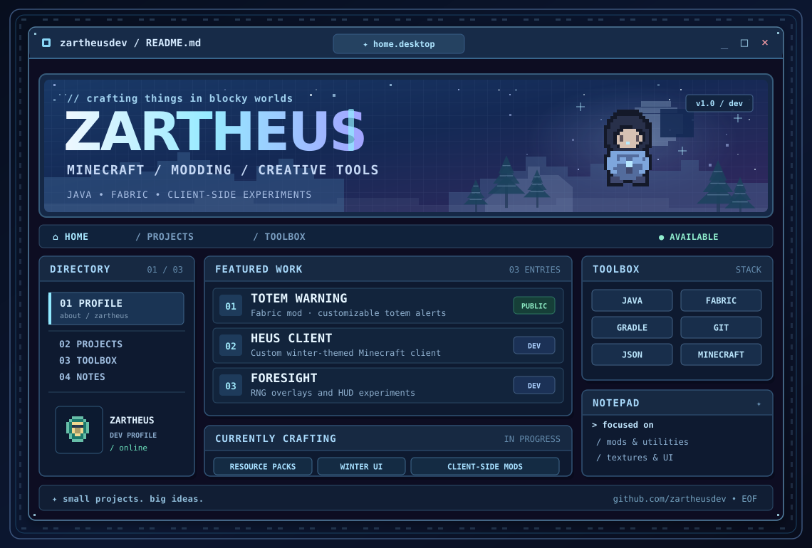

  

  <a href="https://github.com/zartheusdev/totem-warning"><strong>Totem Warning</strong></a>
  &nbsp;·&nbsp;
  <a href="https://github.com/zartheusdev?tab=repositories">Repositories</a>
  &nbsp;·&nbsp;
  Minecraft mods &amp; creative tools

<b>More about the projects</b>

 

- **[Totem Warning](https://github.com/zartheusdev/totem-warning)** — a customizable, client-side Fabric mod for Totem of Undying alerts.
- **Heus Client** — a winter-themed Minecraft client project, in development.
- **Foresight** — Minecraft RNG and HUD experiments, in development.
- **Resource packs** — visible textures and winter panorama experiments.

